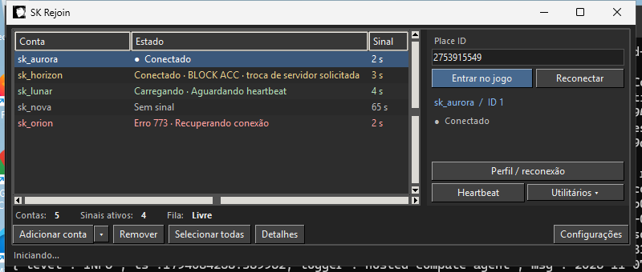
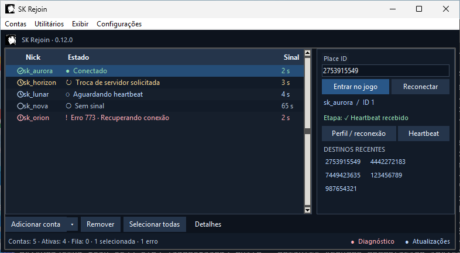
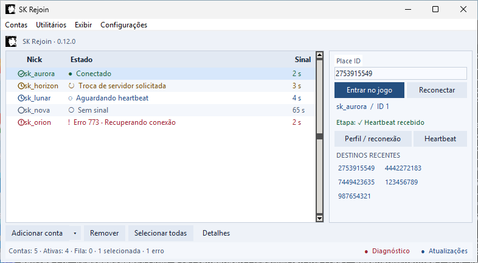

# SK Rejoin

Aplicativo Windows x64 para organizar suas contas Roblox e acompanhar sessões por Heartbeat. O layout compacto mantém os controles de entrada à direita e a lista de contas à esquerda.

## Revamp visual 2 — versão 0.12.0 em revisão

O redesign está na branch `ui/revamp-2`. Não alterou a emissão de tickets, reconexão, BLOCK ACC ou sessões protegidas pelo Windows. **O 403 no resgate do ticket continua sendo um problema funcional conhecido.**

### Antes e depois

As imagens mostram contas fictícias. [Matriz completa](docs/screenshots/) · [Inventário anterior](docs/INVENTARIO_UI.md) · [Validação visual](docs/VALIDACAO_VISUAL.md) · [Histórico](CHANGELOG.md).

## Uso rápido

1. Baixe o executável da versão publicada em Releases. Prévia de branch não é instalada pelo atualizador estável.
2. Use Adicionar conta para login manual oficial; a seta mantém User:Pass e Cookies. Conclua pessoalmente verificações solicitadas no navegador.
3. Selecione uma conta, informe Place ID e use Entrar. Em Heartbeat, copie o script fornecido pelo serviço e configure seu ambiente local. O sinal confirma a conexão observada pelo APP.

Exibir permite trocar tema e organizar colunas. Configurações mantém os controles de inicialização, desempenho, BLOCK ACC e WebLauncher em seções próprias. Perfil / reconexão abre uma janela separada.

Atalhos: Ctrl+N adicionar; Ctrl+F buscar; Ctrl+A selecionar contas com foco na tabela; Del remover; F5 atualizar; Ctrl+Enter abrir; Ctrl+R reconectar; Ctrl+, configurações; Ctrl+K buscar ação. Duplo clique abre detalhes e clique direito oferece ações da conta. A remoção aguarda seis segundos e pode ser desfeita antes do envio ao serviço.

Preferências de tema, colunas e destinos recentes ficam em `sk-ui.json`, separado de contas e perfis. Valores sensíveis são limpos ao iniciar ou fechar a importação. Cookies são exibidos mascarados; não os envie em diagnóstico.

## Limites conhecidos e validação

- Tema do Windows, monitores mistos, nitidez em 125%/150%/200%, atalhos/gestos da bandeja e notificações exigem conferência manual no PC. A matriz automatizada simula escala Tk de 100%/150%; não certifica todos os monitores.
- Aceitação de flags/FPS e teleporte dependem do cliente e do ambiente de Heartbeat. O redesign não muda essas regras.
- Instalação automática via GitHub consulta versões publicadas; dados existentes continuam nos mesmos arquivos. Não há migração do cofre nesta revisão visual.
- A UI pode mostrar o HTTP recebido e o último sinal; não inventa tempos por etapa que o backend não mede.
- Automação de contas pode contrariar os termos da plataforma. Esta UI não implementa evasão, CAPTCHA solver ou garantia contra penalidades.
