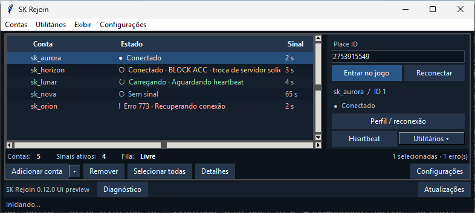

# SK Rejoin

Aplicativo Windows x64 para organizar suas contas Roblox e acompanhar sessões por Heartbeat. O layout compacto mantém os controles de entrada à direita e a lista de contas à esquerda.

## Revamp visual 2 — versão 0.12.0

O redesign foi incorporado à `main` para publicação da versão 0.12.0 pelo GitHub Releases. Mantém os serviços de autenticação, reconexão, BLOCK ACC e os formatos de sessões existentes.

### Antes e depois

As imagens mostram contas fictícias. [Matriz completa](docs/screenshots/) · [Inventário anterior](docs/INVENTARIO_UI.md) · [Validação visual](docs/VALIDACAO_VISUAL.md) · [Histórico](CHANGELOG.md).

A interface refinada tem rodapé em duas linhas, chips acessíveis, colunas automáticas, estados semânticos e destinos recentes. [Comparação completa](docs/screenshots/comparison.png). As larguras ajustadas manualmente são mantidas nas preferências visuais; a coluna Estado absorve a área restante.

## Instalação em Windows recém-formatado

O EXE inclui o interpretador Python e as bibliotecas Python da aplicação. Não é necessário instalar Python, pip, Pillow, pystray ou Playwright separadamente para executar o EXE.

| Componente | Quando usar | Download |
| --- | --- | --- |
| SK Rejoin x64 | Aplicativo | [Versão publicada](https://github.com/danielsolzapo-dev/Sk-rejoin/releases/latest/download/RejoinDesk.exe) |
| Roblox | Cliente do jogo e protocolo registrado no Windows | [Site oficial](https://www.roblox.com/download) |
| Chrome ou Edge | Login manual e User:Pass abrem um navegador instalado; Edge moderno já instalado também serve | [Chrome oficial](https://www.google.com/intl/pt-BR/chrome/) |
| Microsoft Visual C++ v14 x64 | Runtime recomendado em uma instalação limpa; útil se houver erro de DLL/runtime | [Microsoft](https://aka.ms/vc14/vc_redist.x64.exe) |
| WebLauncher | Opcional, para quem usa essa integração em Configurações | [Releases do projeto](https://github.com/vnnaworks/weblauncher/releases/latest) |

Instale o cliente Roblox e um dos navegadores. Abra o SK Rejoin, adicione suas contas e configure o destino. Para Heartbeat, copie novamente o script fornecido pelo próprio APP, com a chave desta instalação. O WebLauncher é uma ferramenta separada e não é requisito para executar a interface do SK Rejoin.

## Uso rápido

1. Baixe o [SK Rejoin para Windows x64](https://github.com/danielsolzapo-dev/Sk-rejoin/releases/latest/download/RejoinDesk.exe). O atualizador consulta as versões publicadas em GitHub Releases.
2. Use Adicionar conta para login manual oficial; a seta mantém User:Pass e Cookies. Conclua pessoalmente verificações solicitadas no navegador.
3. Selecione uma conta, informe Place ID e use Entrar. Em Heartbeat, copie o script fornecido pelo serviço e configure seu ambiente local. O sinal confirma a conexão observada pelo APP.

Exibir permite trocar tema e organizar colunas. Configurações mantém os controles de inicialização, desempenho, BLOCK ACC e WebLauncher em seções próprias. Perfil / reconexão abre uma janela separada.

Atalhos: Ctrl+N adicionar; Ctrl+F buscar; Ctrl+A selecionar contas com foco na tabela; Del remover; F5 atualizar; Ctrl+Enter abrir; Ctrl+R reconectar; Ctrl+, configurações; Ctrl+K buscar ação. Duplo clique abre detalhes e clique direito oferece ações da conta. A remoção aguarda seis segundos e pode ser desfeita antes do envio ao serviço.

Preferências de tema, colunas e destinos recentes ficam em `sk-ui.json`, separado de contas e perfis. Valores sensíveis são limpos ao iniciar ou fechar a importação. Cookies são exibidos mascarados; não os envie em diagnóstico.

## Limites conhecidos e validação

- Tema do Windows, monitores mistos, nitidez em 125%/150%/200%, atalhos/gestos da bandeja e notificações exigem conferência manual no PC. A matriz automatizada simula escala Tk de 100%/150%; não certifica todos os monitores.
- Aceitação de flags/FPS e teleporte dependem do cliente e do ambiente de Heartbeat. O redesign não muda essas regras.
- Instalação automática via GitHub consulta versões publicadas; dados existentes continuam nos mesmos arquivos. Não há migração do cofre nesta revisão visual.
- A UI pode mostrar o HTTP recebido e o último sinal; não inventa tempos por etapa que o backend não mede.
- Automação de contas pode contrariar os termos da plataforma. Esta UI não implementa evasão, CAPTCHA solver ou garantia contra penalidades.

## MuMu / Delta — instalação do APK (0.12.1)

1. Instale e abra o MuMu pelo [site do fabricante](https://www.mumuplayer.com/). Ative o ADB e confira a porta dessa instância nas configurações do emulador.
2. No SK Rejoin, abra **Utilitários → MuMu / Delta — instalar APK** (também em Configurações → Avançado).
3. Selecione o `adb.exe` da instalação do MuMu; se houver mais de um candidato, escolha o correto. Você também pode selecionar o ADB dos [Android Platform Tools](https://developer.android.com/tools/releases/platform-tools).
4. Informe `127.0.0.1:porta`, use **Conectar porta** e selecione a instância. Com várias instâncias, nenhuma é escolhida automaticamente.
5. Clique **Baixar e instalar Delta**. O APP consulta o índice público, baixa um único APK atual e instala somente no destino selecionado. **Instalar APK local** permite usar um arquivo escolhido no PC.

Fonte informada: https://deltaexploits.gg/delta-executor-android. O botão Android dessa página encaminhava para https://delta.filenetwork.vip/android.html; seu índice público é `get_files.php`. O instalador utiliza esse índice e recusa HTML, arquivo incompleto, tamanho divergente ou estrutura de APK inválida. Se a fonte mudar ou exigir uma etapa manual, o APP informa o erro e oferece o site/APK local; não executa JavaScript recebido nem resolve desafios.

A instalação é enviada por `adb -s INSTANCIA install -r APK`. O Android verifica a assinatura; divergência de assinatura não leva a desinstalação automática. Dados e sessões do SK Rejoin não são enviados ao download/ADB. Cancelar não desfaz uma instalação que o Android já recebeu. Confira o resultado no MuMu e conclua pessoalmente a configuração do aplicativo instalado.

Não há certificação do fabricante do APK pelo SK Rejoin. O hash mostrado é calculado localmente para identificar o arquivo recebido. Esta etapa instala o APK; não implementa reconexão dentro do Android, execução de scripts nem garantia de compatibilidade do Delta/Roblox no emulador.

Validação: `tests/test_mumu_installer.py` cobre destino local exato, múltiplas instâncias, rejeição de USB/endereço remoto, cancelamento, integridade estrutural, limpeza de download parcial, preservação em falha de assinatura e smoke nativo da janela. A instalação real no MuMu não foi executada pelo CI.

## Copiar sessão de uma conta (0.12.2)

Selecione uma conta e use **Contas → Copiar cookie…** ou o menu do botão direito.
No diálogo, escolha somente cookie ou `nick:senha:cookie` e clique em Copiar.
A sessão vem apenas do cofre local deste usuário Windows. Não há busca em outros
navegadores/computadores nem envio de cookies ao GitHub ou novo endpoint HTTP.

Como o Rejoin não guarda senhas, o formato completo pede que você digite a senha
para aquela cópia. Ela não é recuperada do cookie, não é validada pela exportação,
não é salva e o campo é limpo ao iniciar a cópia/fechar. O cookie não aparece no
diálogo. Cada exportação é de uma única conta, e a área de transferência é limpa
após 30 segundos se você ainda não tiver copiado outro texto. Isso não apaga
históricos ou cópias já mantidas por outros aplicativos. Fechar o Rejoin antes do
prazo interrompe o timer; limpe a área de transferência manualmente nesse caso.
