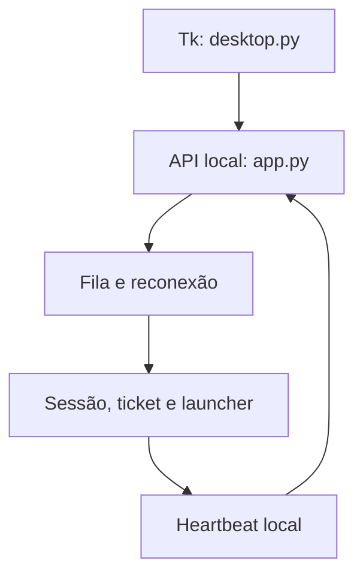

# Arquitetura atual e direção de migração

A UI envia pedidos em workers e recebe callbacks pela fila drenada na thread Tk. A API autentica papéis distintos para administração, Tracker e heartbeat. A fila serializa aberturas, confere PID/criação e espera heartbeat novo. O Roblox resgata o ticket fora do processo Python: emitir HTTP 200 e invocar o protocolo **não confirmam login**.

Dados ficam no usuário Windows; sessões permanecem DPAPI. `json_store.py` mantém os formatos legados, substitui arquivos com temporário único e backup, sinaliza recuperação e falha de forma explícita sem backup válido. Seu lock cobre leitura/substituição dentro do processo, não transações compostas em processos diferentes. Diretórios externos de flags também preservam seu JSON nativo.

`redaction.py` centraliza padrões de segredos nos limites de histórico, diagnóstico e retorno de erro HTTP/UI. Não é garantia contra um segredo arbitrário não identificado; a próxima fase precisa catalogar todos os emissores/tracebacks e introduzir logging estruturado.

Atualizador: SHA-256/tamanho; substituição por PowerShell e `.previous`. **Ainda falta healthcheck/rollback.** A branch de auditoria muda publicação para tags, separando o job com permissão de escrita do build com leitura. Nenhuma versão estável é publicada por PR/push.

`launcher.s` é Assembly x64 legado; o build suportado usa `app.py` e PyInstaller. Não foi removido para preservar possíveis consumidores externos.

Destino futuro: `src/skrejoin/core`, `infra`, `ui` e `integrations`, mantendo shims dos entrypoints legados durante a migração. Essa migração e máquina de estados explícita **não estão concluídas nesta primeira PR**. Ver `AUDITORIA.md` e `PLANO.md`.
